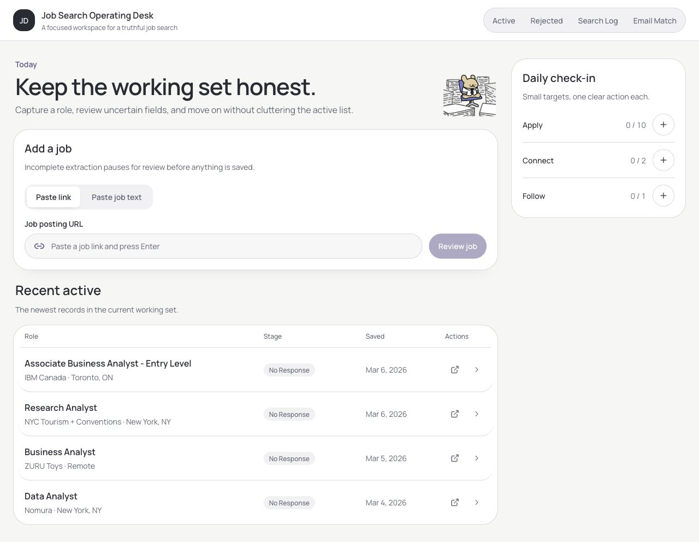
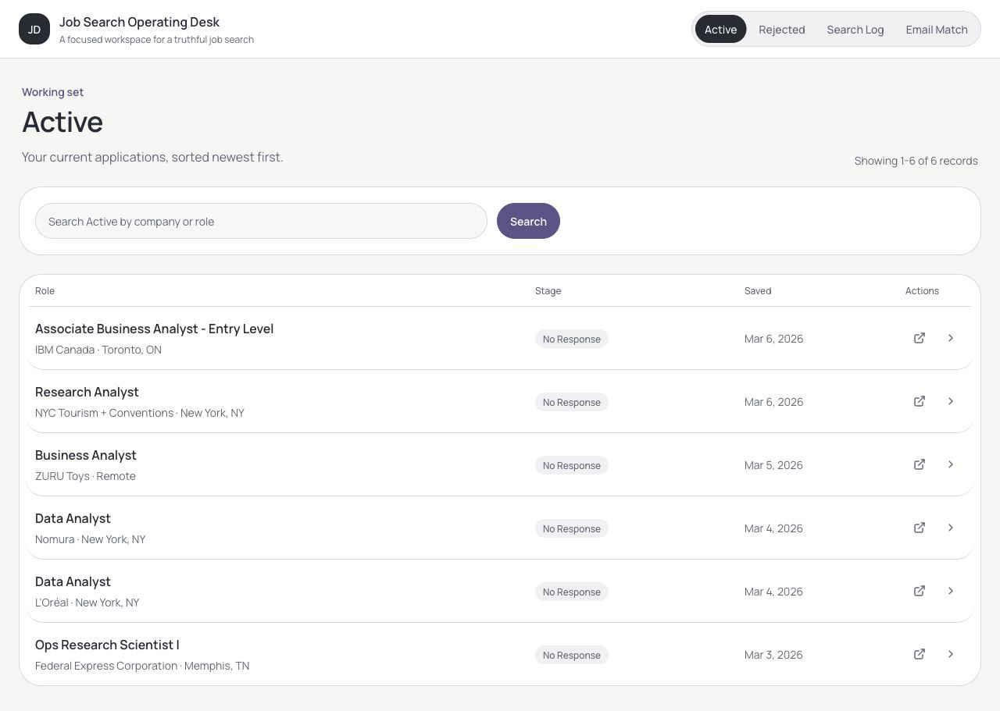
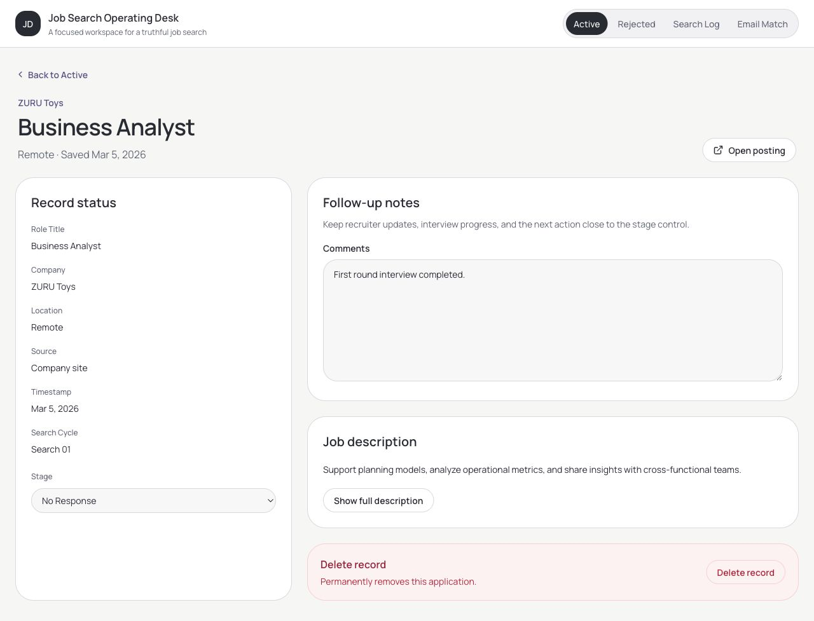
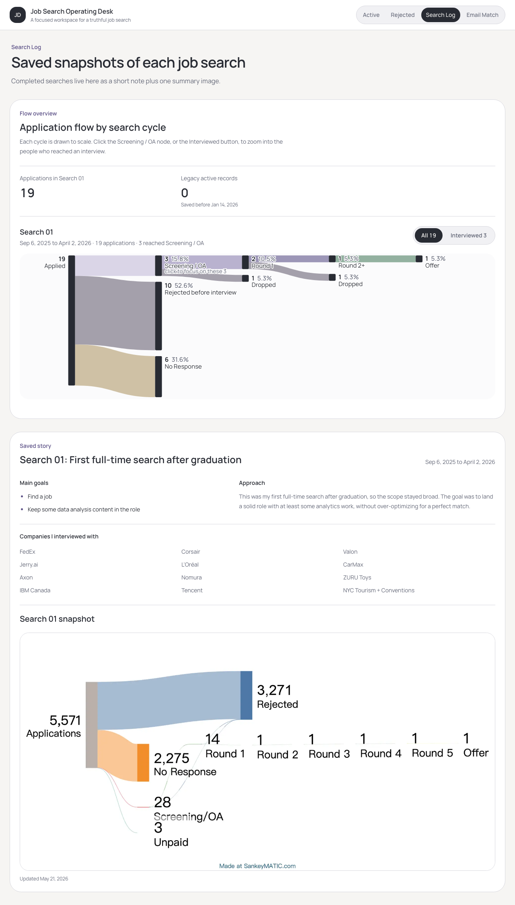
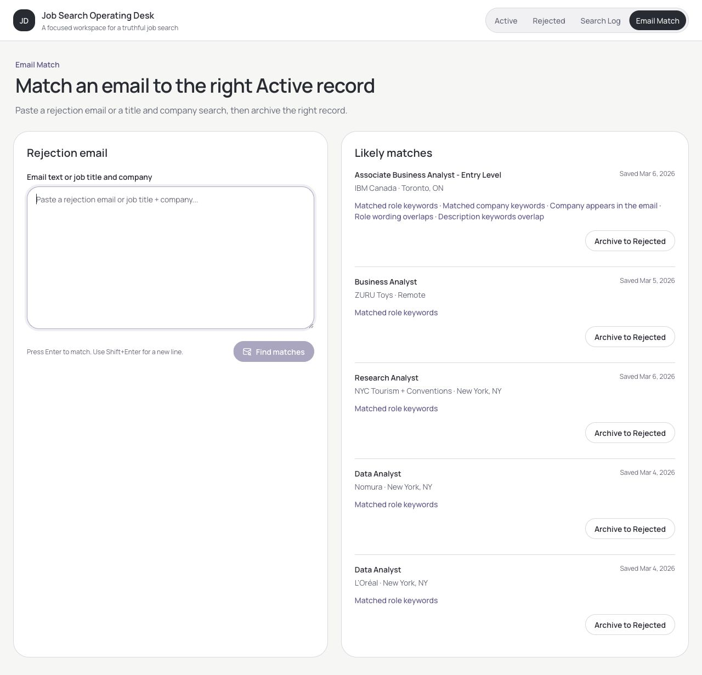
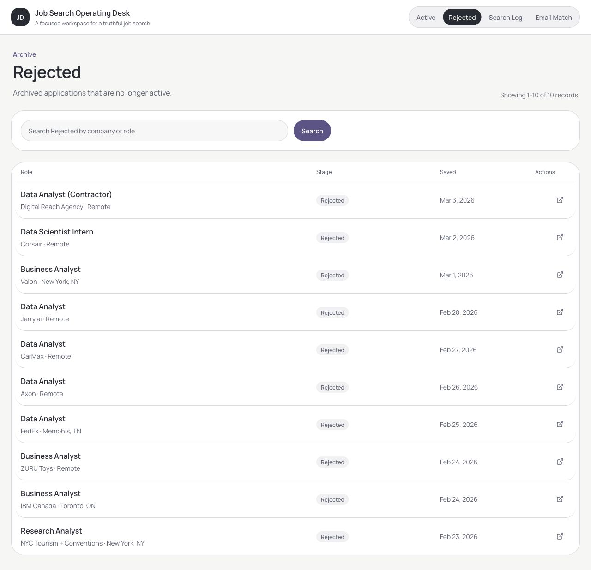
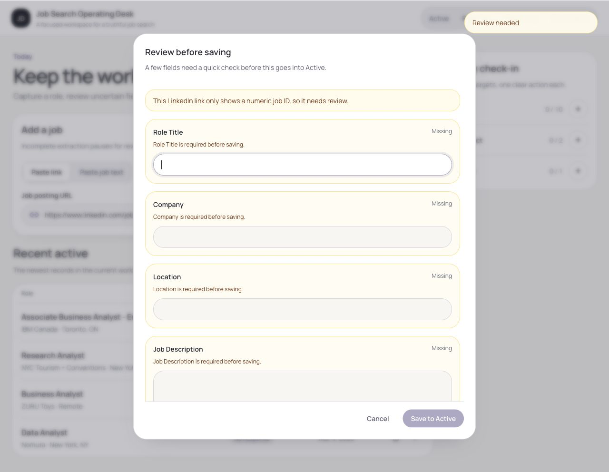
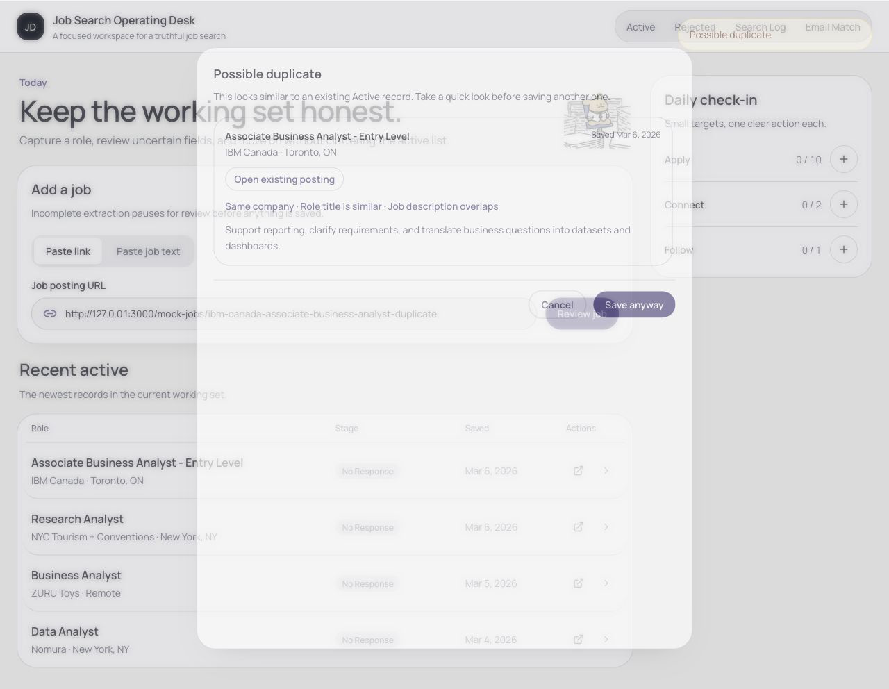

# Screenshot gallery

These screenshots are generated from the app's local seed data. They do not contain a real user's application records.

## Home

## Active

## Application detail and follow-up

## Search Log

One funnel per search cycle; the Interviewed toggle zooms the same chart into the people who reached an interview.

## Email Match

## Rejected archive

## Manual review

## Duplicate detection

